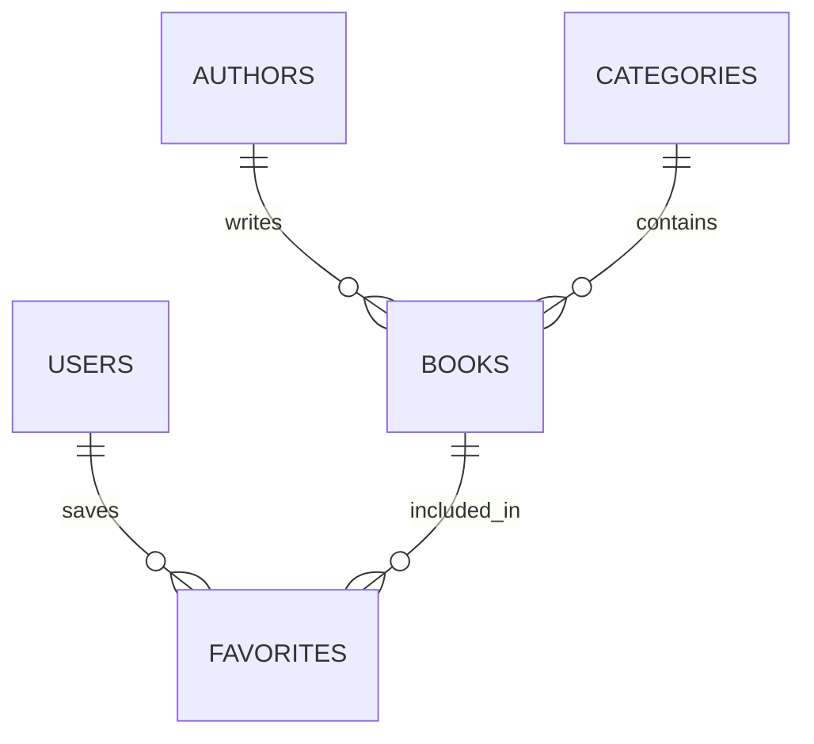

# ER-диаграмма – Қазақ әдебиеті онлайн кітапханасы

## Дерекқор атауы: qazaq_library

Жобада 5 негізгі кесте қолданылады:

1. users – пайдаланушылар.
2. authors – ақын-жазушылар.
3. categories – әдеби жанрлар.
4. books – кітаптар мен шығармалар.
5. favorites – таңдаулы кітаптар.

## Кестелер арасындағы байланыстар

- Бір автор бірнеше шығарма жаза алады.
- Бір жанрда бірнеше шығарма болады.
- Бір пайдаланушы бірнеше кітапты таңдаулыларға қоса алады.
- Бір кітапты бірнеше пайдаланушы таңдай алады.

## ER-диаграмма коды

